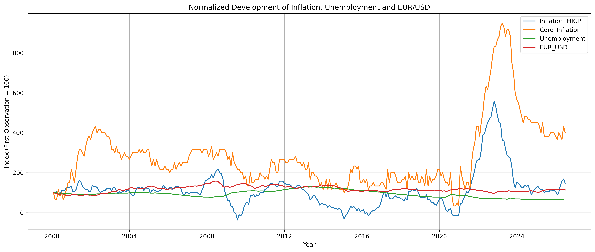
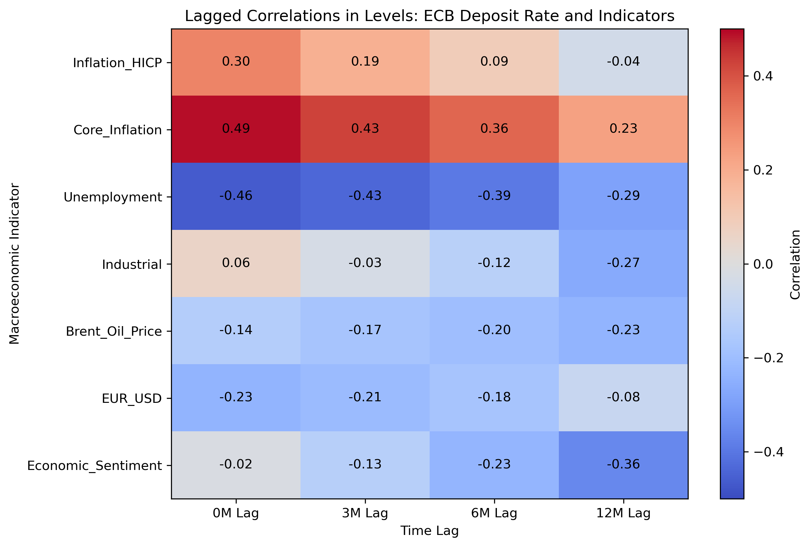
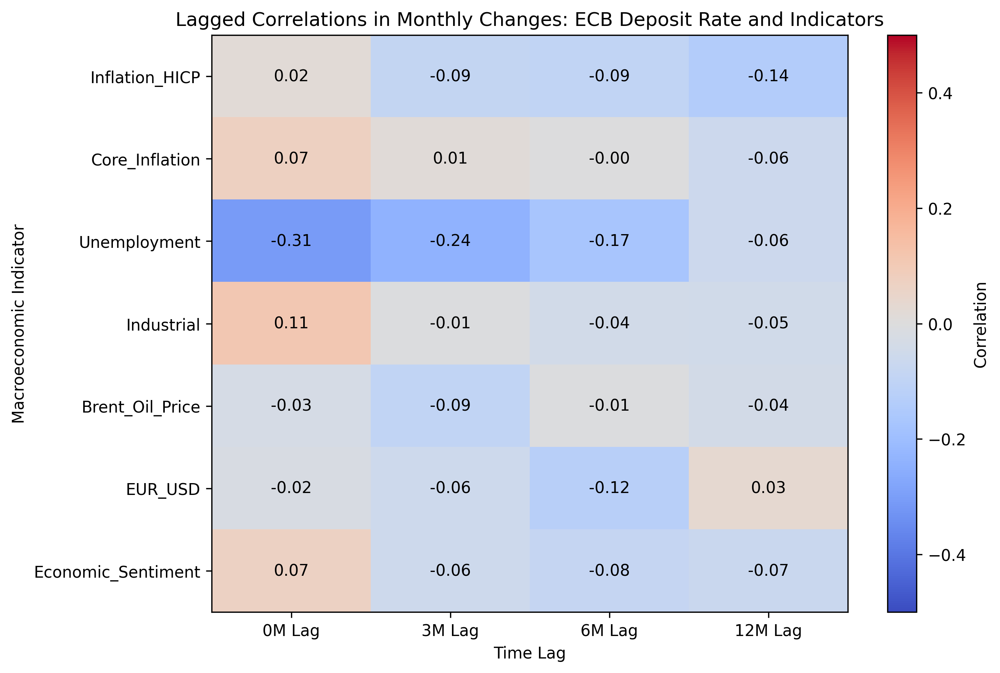
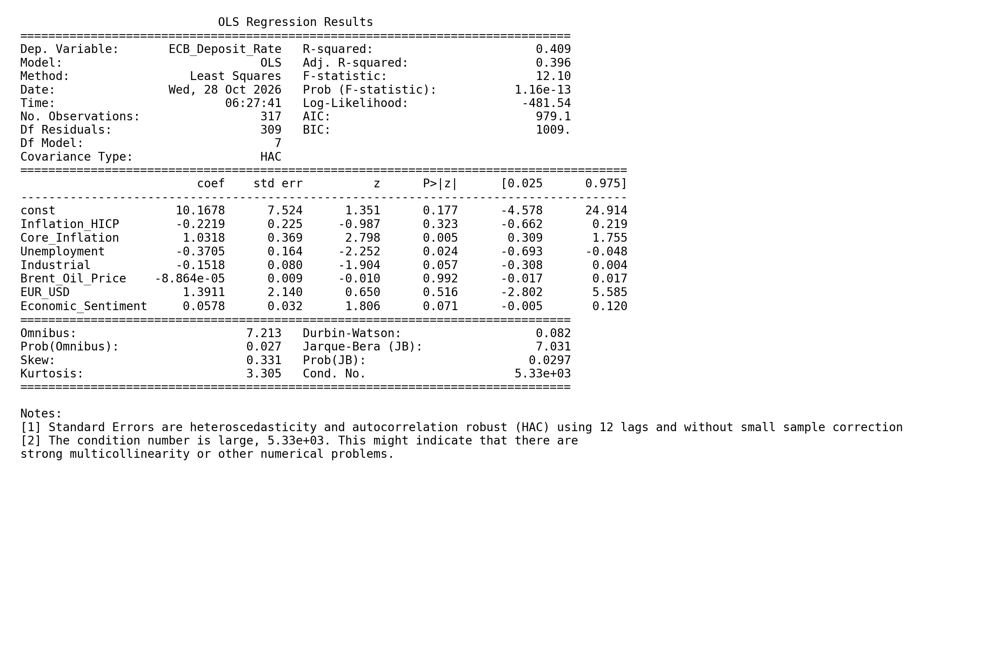

# ECB Interest Rates and Macroeconomic Indicators

Economic models such as the Phillips curve and the Taylor rule describe relationships between inflation, economic activity and monetary policy. I wanted to explore these relationships using real-world data and see how different macroeconomic indicators are statistically related to the ECB deposit facility rate.

## Analysis

Using monthly data from the ECB and FRED, I examined the relationships between the deposit facility rate and seven macroeconomic indicators:

- HICP and core inflation
- Unemployment
- Industrial production
- Brent crude oil prices
- EUR/USD exchange rate
- Economic sentiment

The analysis includes time-series visualizations, correlation matrices, correlations across different time horizons, and a multiple OLS regression. I also compared correlations in data levels with correlations in monthly changes and used HAC/Newey-West standard errors for the regression.

## Key Results

### Time-Series Visualizations

The development of selected macroeconomic indicators over time, normalized to the first observation.



### Lagged Correlations

Correlation heatmaps comparing relationships in data levels and monthly changes across different time horizons.





### OLS Regression

Regression results for the ECB deposit facility rate using seven macroeconomic indicators, with HAC/Newey-West standard errors.



## Project Structure

```text
├── raw_data/                  # Original datasets
├── data/                      # Processed datasets and macro_data.csv
├── images/                    # Figures used in the README
├── 01_data_preparation.py     # Data cleaning and preparation
├── 02_analysis.py             # Visualizations and empirical analysis
└── README.md
```

## Data Sources

- [ECB Data Portal](https://data.ecb.europa.eu/)
- [FRED – Federal Reserve Bank of St. Louis](https://fred.stlouisfed.org/)

## Tools

Python · pandas · Matplotlib · statsmodels · NumPy